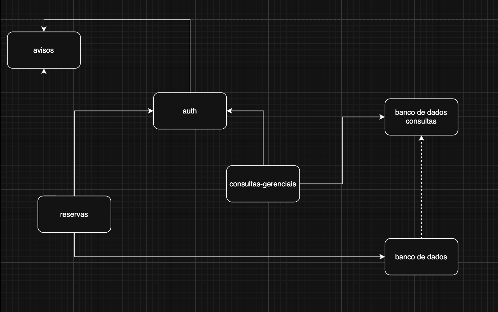

Encontro_02_Fichas_Praticas_Alunos 2) 2.1) A plataforma é destinada a cerca de 2.000 usuários e 60 equipamentos. O sistema deve permitir consultar recursos, solicitar um intervalo de uso, analisar uma solicitação quando necessário, confirmar uma reserva e avisar interessados. A meta de consulta é 95% das respostas em até 2 s, sob carga a especificar. Pesquisadores precisam consultar e solicitar equipamentos compartilhados; técnicos registram manutenção e indisponibilidade; gestores acompanham o uso.

2.2) Consultas gerenciais, funcionalidades das reservas, disparo de avisos.

.3.2) - módulo .

2.3.3) consultas-gerenciais - módulo que centraliza consultas gerenciais, acessa banco de dados levemente dezatualizados performáticos para grandes consultas - necessidades técnicas de consultas complexas.

2.3.4) -

<table style="min-width: 75px;">
<colgroup><col style="min-width: 25px;"><col style="min-width: 25px;"><col style="min-width: 25px;"></colgroup><tbody><tr><td colspan="1" rowspan="1">
Nome do módulo
</td><th colspan="1" rowspan="1">
Responsabilidade principal
</th><th colspan="1" rowspan="1">
O que deve esconder
</th></tr><tr><td colspan="1" rowspan="1">
reservas
</td><td colspan="1" rowspan="1">
Resonsável por gerenciar criação, consulta e gerenciamento geral das reservas
</td><td colspan="1" rowspan="1">
Ciclo de vida das reservas.
</td></tr><tr><td colspan="1" rowspan="1">
avisos
</td><td colspan="1" rowspan="1">
Responsável pela centralização de disparo de avisos, para inicio de reservas, confirmação de reservas ou e-mail genéricos
</td><td colspan="1" rowspan="1">
Orquestração e controle de envio de e-mails.
</td></tr><tr><td colspan="1" rowspan="1">
consultas-gerenciais
</td><td colspan="1" rowspan="1">
Responsável por centralizar consultas gerenciais
</td><td colspan="1" rowspan="1">
Necessidades técnicas de consultas complexas. Acessando banco de dados levemente dezatualizados performáticos para grandes consultas.
</td></tr><tr><td colspan="1" rowspan="1">
auth
</td><td colspan="1" rowspan="1">
Responsável por garantir autenticação e autorização correta dos usuários do sistema.
</td><td colspan="1" rowspan="1">
Lógicas de negócio complexas baseado em diferentes perfis.
</td></tr></tbody>
</table>

3.4

3.B)

| De → Para | O que a interface oferece (em linguagem neutra) |
| --- | --- |
| reservas→avisos | Oferece disparo notificações para usuários em situações diferentes, ex.: reserva confirmada. |
| consultas-gerenciais→auth | Confirma credenciais do cliente e que ele tem acesso para acessar o que deseja. |
| reservas→banco de dados | Produz o ciclo de vida confiável da reserva. |
